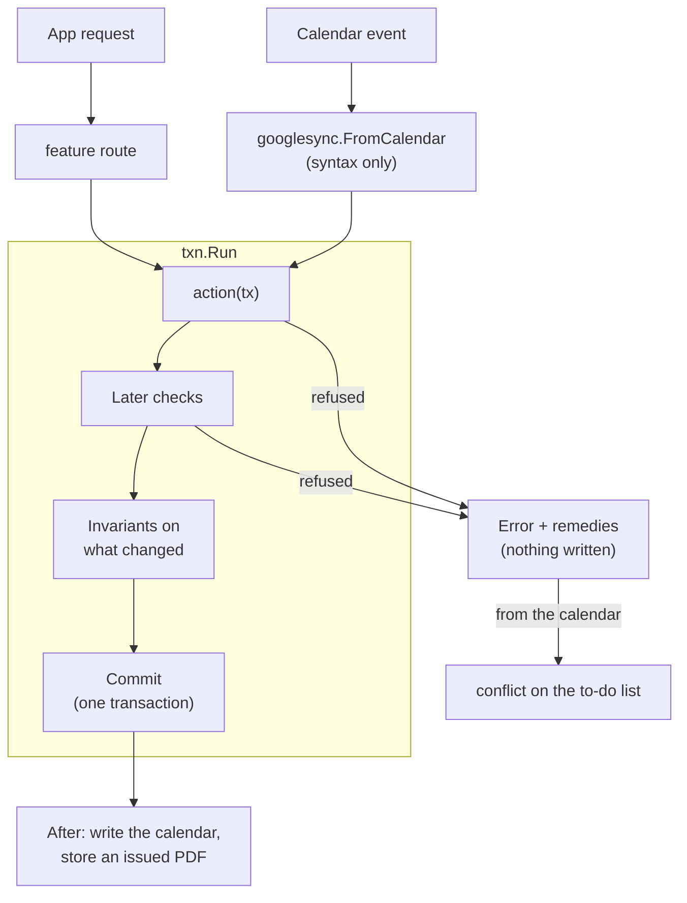

# bizzy

Back-office for a one-person physio practice: sessions, packages, invoices and receipts, follow-ups, expenses. Sessions are booked in Google Calendar or in the app.

## Design principles

1. **bizzy is the truth; Google Calendar is a command surface.** A calendar edit is read as the command the app would send, under the same rules. Every event in the chosen calendar is bizzy's (a session, a follow-up `!`) or refused. A refused edit waits on the to-do list with remedies, one of which always puts bizzy's version back. Google Contacts is the truth for contact details (the app keeps a read-only copy); a client's IC or passport number is bizzy's.
2. **Documents own money.** A fee is its invoice line, a payment its receipt line. Drafts are made with every booking and payment and stay editable until issued. An issued document changes only by non-legal corrections (a new revision) or by cancelling.
3. **An issued document is printed once.** Issuing renders the PDF in the API and commits its SHA-256 with the revision; the file is then kept in S3 (locked for 7 years in production) and served as kept, stamped CANCELLED once cancelled. A lost file is re-rendered only if it matches the hash. So the layout can change freely: only new documents look new. Drafts render fresh, watermarked DRAFT.
4. **The app never reaches an invalid state.** Every change is an action that checks its rules before anything is written. A refusal changes nothing and offers remedies. Invariants are checked again before every commit.
5. **Delete undoes a mistake; history stays.** An item with history (it happened, something was recorded, money or an issued document covers it) is cancelled or archived instead (see [Lifecycle](#lifecycle)), and stays readable.
6. **No business rule in the web app.** Every view carries `can` (a verdict per action: ok, or why not plus remedies) and `locked` (fields its update can't change now). The web shows and disables by them, never by reading state. PDFs come from the API too.
7. **Every rule is tested by use.** A property-based simulation drives every action, the calendar and the clock in random order, checking every invariant after every step.
8. **Reads are the budget; Google is the wait.** The table is small and provisioned, and every consistent read costs a unit however small the item, so reads add up per call, not per byte. A request reads the versions item and what changed since; a response says what it changed and each kind's version, and the web reads again only what shows those, its own changes and any made elsewhere; a page is one call. A call to Google takes hundreds of milliseconds: none is made twice in a request, and those that don't wait on each other run at once.

Conventions: identifiers say "user", never "her". Production holds data, so every change to how items are stored is a [migration](#migrations), never a reset.

## Tech stack

| Folder | What | Stack |
| --- | --- | --- |
| `bizzy-web` | The app (SPA, installable as a PWA) | React 19, Vite, TanStack Router / Query / Form / Table, Tailwind, shadcn/ui, Amplify auth, vite-plugin-pwa, Vitest |
| `bizzy-lambda` | API, calendar/contacts sync, PDFs, jobs | Go, DynamoDB (single table), S3, fpdf, `pgregory.net/rapid` |
| `bizzy-infra` | AWS resources | CDK (TypeScript) |

Sign-in is Google via Cognito. Only `ALLOWED_EMAIL` gets identity-pool credentials, which the browser uses to invoke the API Lambda directly (no API Gateway). Calendar and Contacts use a separate OAuth consent (**Settings → Connect Google**); the refresh token is in SSM.

## Code layout

```
bizzy-infra/    bin/bizzy-infra.ts → lib/{auth,data,api,web}-stack.ts, bin/bizzy-ci.ts → lib/ci-stack.ts, constructs in lib/common/
bizzy-lambda/   cmd/{api,public,job-quarterly,migrate,copy}/main.go, internal/{app,features,migrations,platform,calendar,snapshot,simulation,testutil}/
bizzy-web/      src/main.tsx, src/routes/ (file routes), src/features/<feature>/
scripts/        web-env.mjs: writes bizzy-web/.env.<env> from stack outputs; migrate.mjs, copy.mjs, replay.mjs: run cmd/migrate, cmd/copy, TestReplay
```

### bizzy-infra

[bin/bizzy-infra.ts](bizzy-infra/bin/bizzy-infra.ts) reads `.env.<ENVIRONMENT>` and creates `<project>-<env>-{auth,data,api,web}`:

- **auth**: Cognito user pool (Google IdP) and identity pool, mapped to `ALLOWED_EMAIL`.
- **data**: the DynamoDB table (5 generic LSIs, created up front) and the file bucket: `attachments/` and issued PDFs under `documents/`. Production versions it (35-day noncurrent expiry) and has Object Lock on. Also the payment page's site, in every environment: its own bucket (no versions; Settings rewrites it) behind CloudFront.
- **api**: the `api`, `public` (share links: a Function URL that can only `GetItem` and read issued PDFs), `job-quarterly` (EventBridge) and `migrate` (run by deploys) Go Lambdas.
- **web** (staging and production): S3 and CloudFront for the SPA, made first: its URL is the first of Cognito's callback and logout URLs and of the file bucket's CORS origins, before any from `CALLBACK_URLS`. A deploy drops the previous build's files, and the bucket keeps no versions, so no old build is kept. Each deploy also deletes the Lambda builds no stack uses from the CDK assets bucket (`cdk gc`).

[bin/bizzy-ci.ts](bizzy-infra/bin/bizzy-ci.ts) is a separate app, `bizzy-ci`, deployed by hand (`pnpm ci:deploy`) so a deploy can't change what deploys may do. It holds `bizzy-{staging,production}-github`, the roles [deploy.yml](.github/workflows/deploy.yml) assumes through the account's GitHub OIDC provider (made by hand and shared with other projects, so only looked up). Each is assumable only from its GitHub environment, and may do only what the workflow does outside CloudFormation, on its own environment (the migrate Lambda, reading the table, the site upload), plus `cdk gc`'s reads. `cdk deploy` goes through the bootstrap roles, which serve the whole account, so this scoping prevents mistakes; the GitHub environments' branch rules are what keep `main` out of production.

### bizzy-lambda

[cmd/api](bizzy-lambda/cmd/api/main.go) builds [internal/app](bizzy-lambda/internal/app/app.go), which wires one `txn.Runner`, the calendar sync and every feature's routes. The router dispatches `{action, payload}` to a `Query` or a `Mutation`.

**Every change is an action run by `txn.Run`**, whether from the app or the calendar:



- **Actions** are plain functions of a `txn.Tx` (`sessions.Update(tx, id, fields)`); nothing is written until they return. `Fields` is a patch, applied in steps that each check their rules and refuse with `apperr.Refused(message, remedies…)`. Rules across items (overlap) use `tx.Later`, so changes made together are judged together.
- **Invariants** (`<feature>/invariants.go`) are checked on every item a commit changes. One that breaks is a bug: an internal error, nothing written.
- **Commits are checked by partition**: one item holds every partition's version; a commit goes through only if nothing it read or writes moved since it began, else the action reruns on fresh data.
- **Reads are kept** ([txn/cache.go](bizzy-lambda/internal/platform/txn/cache.go)): what a warm Lambda read stays in memory while its partition's version holds, and its own commits update it, so most runs read only the versions item. A kind of few, much-read items is `Whole`: read whole once, every read answered from it. A query that stops at a `Limit` reads only that many.
- **A request is one `txn.Scope`**: the kinds its commits changed go back as `changed`, the partitions' versions it last saw as `versions` (in decimal, too big for a JavaScript number), and work after commits waits for its end, done once. The Lambda logs a `request` line for each: action, ms, and its table reads, commits and Google calls.
- **The calendar is an adapter.** `googlesync` keeps a `Link` per event (its session, and what both said when last agreed). A changed event becomes `sessions.Create`/`Update` with only what the user changed, one commit per event; a deleted one deletes its session, or cancels it when it has history. Refused events retry after the others (together, for a swap), then wait as conflicts. Changed sessions are written to their events at the end of the request, `Parallel` calls at a time and recorded in one commit, over each event as the request last saw it (Google refuses a write over a newer one); the next sync finishes a failed write, writing only events that differ. A calendar is read 60 days back, then backfilled a month per `sync.backfill`. Choosing another calendar keeps bizzy's data, writes every item into the new one and leaves the old one untouched.
- **PDFs** are laid out by `platform/pdflayout`, a small QuestPDF-style layer over fpdf: blocks (`Text`, `Row`, `Column`, `Flow`, `Table`, …) measure their height and draw themselves, and pages break between blocks only (a table between rows, its header repeated). Output is byte-for-byte repeatable, which the hash relies on. [documents/render.go](bizzy-lambda/internal/features/documents/render.go) is the layout; `pdf.go` keeps and serves the files (`documents.pdf`, `documents.preview`, the share link).
- **The payment page** ([settings/paypage.go](bizzy-lambda/internal/features/settings/paypage.go)) is static files on its own site: every Settings save renders the page (DuitNow QR, bank details, the phone e-wallets pay), the QR drawn again from what it says, and the preview WhatsApp shows, and writes them after the commit. A failed write fails the save's reply, so saving again mends it. Opening the page costs no Lambda call and no read. It shows only what every payment message already sends, so its address is fixed. Its robots.txt lets in only link-preview bots (WhatsApp, Facebook, Telegram), so the link shows a card but isn't indexed. The message links it as `{payLink}`, with a `{ref}`: the invoice number, or the client's first name and the day (`AISYAH 05OCT`).
- **WhatsApp messages** ([documents/ask.go](bizzy-lambda/internal/features/documents/ask.go)) have two intents. *Ask to pay* (`documents.ask`) turns items (a session's `sources`, a package) and invoices into what is owed: an item on an issued invoice as that invoice, with its link; one on a draft as its own line. *Send for records* (`documents.records`) is the issued documents covering items, sent only when a client asks. Views say both as `askToPay` and `sendRecords`; the web fills in the user's templates (the app's wording while blank).

**Names** are the same in every feature. Outside a package you read `sessions.View`; the web writes `SessionView`.

| Role | Name | ASP.NET Core equivalent |
| --- | --- | --- |
| Stored entity | `Session` | Entity |
| Its storage | `Sessions` (a `txn.Kind`) | `DbSet<T>` / repository |
| What an action changes | `Fields` (a patch) | Command model |
| Actions | `Create`, `Update`, `Delete`, … | Application service / handler |
| Route input | `createRequest`, `idRequest`, … (private to `api.go`) | `XxxRequest` |
| Route output | `View` (never the stored entity) | Response DTO / view model |
| Routes | `Routes(r, run)` | Controller |
| Whether an action would be taken | `Can<Action>(tx, item) error` → the view's `Can` | Policy / authorization handler |
| Fields an update can't change now | `Locks(tx, item)` → the edit view's `Locked` | Read-only field metadata |
| Rules that always hold | `Invariants` | Domain invariants |
| Wiring | `app.New` | DI container / `Program.cs` |

**Layout:**

- `internal/features/<feature>/`: `api.go` (routes, views, requests, `Locks`), the entity file (model, `txn.Kind`, to-do), `actions.go` (actions and their `Can…`), `invariants.go`, and a file per other job (`translate.go`, `render.go`). Features import only what they build on; `app` passes in the reverse (`clients.Owner`). [app/dependencies_test.go](bizzy-lambda/internal/app/dependencies_test.go) enforces it.
- `internal/platform/`: `router`, `apperr`, `txn`, `table` (storage interface, in-memory version, shared contract), `listing`, `migrate`, `dynamo`, `blobstore` (S3), `pdflayout`, `googleauth`, `ssm`. Imports no feature.
- **Long lists are searched, not loaded**: one `<feature>.search` per kind takes a `listing.Request` (words, days, the page to start after) and optional filters, narrows the read with the most selective index they allow (`txn.List`: a client's, a tag's, the open ones, else by time), filters the rest in Go (not DynamoDB filter expressions, which bill every item read and can't see what a view works out), and returns a `listing.Page`, ending when full or after `listing.Budget` items.
- **A list across kinds** (`timeline.search`) pages one kind (a client's sessions) and takes the others within the time each page spans; its cursor carries both. What is coming comes whole with the first page.
- **A page is one call.** Parts from features that can't import each other are composed by `app` in one read (`app.status`, `sessions.page`, `insights.year`); a feature exports the function (`sessions.Full`), not only the route.
- `internal/calendar`: Google Calendar events, title syntax and client, knowing no feature.
- `internal/testutil`: `testapp` (the whole app on the memory table, with fake Calendar, Contacts and S3).
- `internal/simulation`: a rapid state machine over `testapp`, one action per mutation (enforced) plus calendar edits and clock moves. After each step it checks every invariant, that a refusal changed nothing, that each view's `can` matches the API, that every issued PDF is kept as issued, and that once synced the calendar shows bizzy.
- **Refusals are written once**, as a read-only `Can<Action>(tx, item) error` the action calls first. Each view has a `Can` struct (`apperr.VerdictOf`) and, for an update with rules, `Locked` (`apperr.LocksOf`, keyed by JSON path). The simulation calls each mutation as its view said (`callAsViewed`, `callAsLocked`); the action's refusal stays the last word.
- **Storage**: one partition per kind (`PK` = `SESSION`, `SK` = id), the item's JSON in `data`, five LSIs (time, client, open, tag, ref) filled through `txn.Meta`. [SCHEMA.md](bizzy-lambda/SCHEMA.md) is generated from the code; a test fails when it is stale.
- **A new feature** adds those four files, three lines in `app/app.go` (routes, invariants, kinds), a row in `dependencies_test.go`, a `Doc` per kind, a `Can…` per action in its view, a place in [Lifecycle](#lifecycle), a simulation action per mutation, a row per kind in the web's `CHANGED_KEYS`, and a loader (`pageData`) on its page's route.

#### Lifecycle

**Delete** is for a mistake, refused once the item has history. After that it is **Cancelled** (void, kept as it was) or **Archived** (put away, undone by unarchiving). Both stay readable, behind a list chip.

| Entity | Delete while | Then |
| --- | --- | --- |
| Session | not happened (or tentative), nothing recorded, no payment, no issued invoice | **Cancel**: keeps its record, holds no time, costs nothing (credits freed, fee line dropped, a package bought in it kept), leaves the calendar |
| Client | nothing of theirs | **Archive**: out of lists and pickers, nothing new booked until unarchived |
| Package | no credits used, no payment, no issued invoice | Stays; the list hides it once used up and paid |
| Document | a draft never issued (discard) | **Cancel**: number stays used, PDF stamped CANCELLED, lines go back to a draft |

#### Migrations

The table's SQL-style migrations. The code serves only a table at its own version (`migrations.Version`, in the `SCHEMA` item), so it reads items in the shape it writes them.

- **Every change to a stored type or a `Meta`** needs one. `TestSchema` refuses to `-update` SCHEMA.md without one. One with no `Up` is enough when no item needs changing by hand: every run rewrites every item as the code writes it.
- **Writing one**: `internal/migrations/NNN_<what>.go`, appended to `All` (never reorder or change a deployed one). It works on stored JSON (`migrate.EachItem`), never a feature's types, imports only `platform`, changes nothing when run twice, and has `testdata/NNN/{before,after}.json`.
- **Trying one**: `pnpm data:replay production` runs it on production's data in memory (see [Trying changes](#trying-changes-on-productions-data)).
- **Deploying**: CI dry-runs the migrations on an in-memory copy, deploys, then invokes `cmd/migrate`: back up (production; backups older than 35 days are deleted, point-in-time recovery covers them), raise the fence (requests get `unavailable`), migrate, decode every item strictly, rewrite them, check every invariant, lower the fence. A failure leaves the fence up until a fixed migration runs.
- **Capacity**: the table's 5 reads and writes a second would take hours over every item once it holds a few years of data. So every run over every item (a deploy's review and dry run, a migration, `data:copy`, `data:replay`) first raises the capacity to what the table's size needs to finish in about 5 minutes, then sets it back ([dynamo/capacity.go](bizzy-lambda/internal/platform/dynamo/capacity.go)). Capacity is billed by the hour it is set, used or not, so a raise costs cents, and a small table is never raised.

### bizzy-web

[src/main.tsx](bizzy-web/src/main.tsx) → `router.tsx` → `src/routes/` (file routes that only read params and render a page). The API is called through `invoke(action, payload)` in `core/lambda/lambda.client.ts`.

- `src/features/<feature>/` files are `<kebab-name>.<layer>.ts(x)`, one dot before the layer. The feature's main file is `<feature>.<layer>` (`sessions.form.ts`); a topic of its own is `<entity>-<topic>.<layer>`, the entity singular (`session-stage.util.ts`, `package-save.hook.ts`). Layers in dependency order: `types`, `constant`, `config`, `util`, `form`, `service`, `query` / `mutation`, `hook`, `list` (what an entity's page steps through), `columns`, `component`.
- Pages are `x-page.component.tsx` at the feature root; other components live in `components/<name>/`. Components reach data only through `query`, `mutation` and `hook`, never a `service`.
- A feature's `types` mirror its `api.go`: output is `<Entity>View`, what a create or update sets is `<Entity>Fields` (an update sends only what changed), other input `<Action><Entity>Request`.
- `core/` is shared infrastructure (`lambda`, `list`, `navigation`, `scroll-spy`, `viewport`, `utils`), `components/shared/` the app's shared components by role (`actions`, `dialog`, `feedback`, `form`, `layout`, `link`, `list`, each a folder per component, named for its main export, which its others share as a prefix: `timeline/` holds `Timeline`, `TimelineItem`, …; the role ends the name: `UnsavedChangesDialog`, `EmptyState`, `DataList` beside `DataTable`), `components/ui/` the generated shadcn components (left untouched). Neither `core` nor `components/shared` imports a feature; ESLint enforces both rules.
- **Every editing surface is a TanStack form** made with `useAppForm` (`components/shared/form`): its fields are the kit's (`<form.AppField name="fee">{(field) => <field.TextField label="Fee" />}</form.AppField>`), its checks the shared ones in `core/utils/form.util` (`requiredError`, `moneyError`, …), checking only what the field shows; the API has the last word. An error shows once a field is left or a submit tried; submit stays enabled (only busy while saving), and a submit that doesn't pass takes the cursor to the first error. Refusals are shown with `toastRefusal`, so their remedies come too. One save covers all an item's editor shows: a package's page holds what was paid for it too, sent with it as `payment`.
- **Fields are never in a dialog**, as a phone's keyboard and anything fixed over the page fight (iOS scrolls the page to the box while the sheet lifts itself), and a page's own scrolling doesn't. A form for an item is its page, a route, on every screen (`/follow-ups/new`, `/packages/$id`, `/clients/$id/payment`); one for part of a page opens in place in its section (a session's Booking, a client's contact, Add sessions). Its Save is the header's main action (`type: "submit"` with the form's id), a form used in more than one place being a hook that returns its fields (`useBookingForm`, `usePaymentForm`). A save that ends it goes back to where it was opened (`useGoBack`), or its list when opened from outside the app. Dialogs only confirm (`SheetAlertDialog`; `typed`, one asking for a reason, sits at the top on a phone) or are read (the calendar guide).
- **The URL names what a link opens; history state carries the way there**: what a new item starts with (`clientId`, `name`, `after`), where it opens (`at: "payment"`), the calendar edit it was opened to settle (`settle`, read by `useSettleReturn`), passed as `navigate({ state })`, typed as `HistoryState` (`router.tsx`). Back, Forward and a reload keep it; a page works without it.
- **Every header says the broader thing first**: `title` is what the page is about (a client, a list), then `kind` and `subtitle` what it is and what narrows it ("Aisyah" · "Invoice · INV260042-00"; a list's preset; Home's quip of the day). The crumb (`parent`) is the list the pager steps through; a phone's ← is the browser's Back.
- **An item's pager steps through the list it was opened from, in that list's order**, kept in its URL: a list's filter (a client's documents or packages section: that list with the client chip); Home (`from=home|today`), a session's or package's page (`session=`, `package=`) or a client's timeline (`timeline=`), a fixed list from what that page read (`TODO_*`, `TODAY_SESSIONS`, `sessionDocumentsList`, `timelineList`), so stepping costs no call. Every link to an item passes it. On a wide screen the header leaves out what its breadcrumb says.
- **An item that moves through stages is laid out as `PageSteps`** (a session, a package, a follow-up: the rail the only place showing where each step stands), anything else as `PageSections`. A new one's page has the steps it will have, the first to do now.
- **A button waiting on what it started is `pending`** (`PendingButton`, an `Action`'s `pending`, `SubmitButton`): its label stays, hidden, so its width does, with a spinner over it; never a "Saving…" label.
- **A call's `changed` and `versions` decide what is read again.** `invoke` hands `changed`, and every kind whose version isn't the one last seen (changed on another device, or by the job), to `refreshChanged`, which invalidates the queries `CHANGED_KEYS` maps each kind to; mutations invalidate nothing themselves but what the API can't see (Google contacts). A call whose page would restart its forms runs in `keeping(key, …)` and updates that page from its result; a backfill's changes are read again once it ends. Queries stay fresh for minutes (`FRESH_MS`) and aren't read again on focus, and what only the app changes (the expense catalogue) until a call says it changed. Instead `useStayCurrent` syncs on load; coming back to the app (tab, window or connection) syncs once the last sync is 10 minutes old, and otherwise asks `app.versions` (about one read); while the app stays in view it syncs every 30 minutes; and each time, what the clock changes (`CLOCK_KEYS`: a session past its start, a follow-up due) is read again once stale. A page's parts `select` from its one query.
- **Waiting and failing look the same everywhere, and nothing jumps.** An entity page's route (and Home's) reads its data in a loader (`pageData`), so the page being left stays up until the next is ready, with a stripe under the nav or the pager's button spinning. A part shows once every query it draws from has data (`allOf`: sessions with their clients' names), so nothing fills in after. Until then it shows `LoadingState`, but only after `--wait-delay`. Loading, empty and not-found states pair a quip with the line drawing it names (honey: the jar), or one at random (`BeeArt`). The drawings are neutral, like the rest of the UI, except an error's, in red; honey is only for the logo. A page's body loads centred like `NotFoundPage`; anything smaller loads as one line shaped like its empty state (`EmptyStateFrame`), so content grows into place. If a read fails, `ErrorState` takes the same place: a drawing of something broken (a bee adrift when offline), Try again, Copy details for the developer, and a `not_found` reads as `NotFoundPage` with the way back. A failed refresh never replaces what is already shown. A table takes its query as `source` and does both in its body, under its header. Once it already shows rows (cached, or the last filter's), it shows the nav's stripe along its top instead. `ErrorMessage` is only for a form's refused save. Only errors that may pass later are retried. In development, `.env.development.local` can slow calls (`VITE_SLOW_ACTIONS`, `VITE_SLOW_MS`) or fail them (`VITE_FAIL_ACTIONS`).
- **`can` and `locked` in the web** (principle 6): an `Action`'s `can` disables it and says why (a `HintTooltip`, the button kept hoverable with `focusableWhenDisabled`, or a line in the ⋯ menu, as a phone has no hover); forms disable what `locked` names, with a `LockedHint` under the field. Status is only shown (badges).
- **Every action is an `Action`**, laid out by an `ActionBar` (or `RowActions`, a `Banner`), so its `can` works the same everywhere. A crowded bar folds all but its main action behind ⋯ below `lg` (`foldBelow`). A section with state of its own (ticked rows) is a hook returning its `PageSection`. Where one goes:
  - **By what it acts on, in one place only**: the whole item in the page header, one section (or session step) beside its heading, one row on the row. Buttons inside content only for one field or line (remove a line, an `InlineField`).
  - **The header**: `actions` is the page's one main job, primary and always shown (New X, Book session, Issue, Save while changed); `moreActions` the frequent ones; `menuActions` the rare and lifecycle ones (Revise, Archive, Cancel, Delete), destructive last. Lifecycle actions are only ever behind ⋯, and are actions, never form fields.
  - **An item's home is its page, with every action on it; its rows only the next step.** A row's step is the same in a table, card, to-do or timeline (Done, Confirm, Add summary, Paid ▾ via `useSessionQuickActions` / `usePaidAction`, Issue), and Paid ▾'s Another day… opens the home at its payment. An item with no home (a shop) keeps its few on the row's ⋯.
  - **A question the item waits on** (not confirmed, a calendar conflict) is a page `Banner` with its answers.
  - **Several ways to do one thing** are one `menu` action (a group behind ⋯). **WhatsApp ▾** on a session, package or document, and on one client's ticked documents, holds Ask to pay, Send for records and Open chat, each by its `can`.
  - **Labels**: "New X" makes a standalone X, "Add X" attaches one to this page's item; verb and noun in a header ("Delete session"), the verb alone in a row. A row with one action (not a lifecycle one) shows it, not a ⋯.
- **On a phone (below md, `useCompactLayout`) the page header leaves the page**, though pages still give it the same props: the bee (always home) and then the title, always on two lines (`kind · subtitle`, else the list it sits under), fill the nav bar, so the title starts in one place on every page; the way back, the pager and the actions go into `PageDock`, a panel floating at the bottom that rides above the keyboard (`useKeyboardInset`; on iOS, which no CSS tells of the keyboard, a box in it takes focus without the page moving, `useFocusInPlace`, and it fades out while the keyboard or the page moves, back once still, `hideWhileMoving`, as iOS moves what is fixed before any script hears of it). Its left edge moves around the list: on an item, ← then ˄ 3/12 ˅; on a list, its `toolbar`, which lays itself out for the dock (`DockContext`): a `FilterBar` is its presets' button (a sheet) and its box folded to a ⌕ that grows over the dock while typed in (the actions give way, suggestions open upward), its chips (the words too) in the tray above the dock, so a filtered list says so however far it is scrolled. Its right holds the actions, each labelled, the main one at the edge (or, with none, the first of `moreActions`), with ⋯ and menus opening as sheets (`ActionSheet`). Below lg the nav bar is the bee and one ☰, opening a sheet with the modules, the sync and the account's; a failed sync marks the ☰. Toasts come up at the bottom on every screen, above the dock (`--dock-height`).
- What is left to set up shows as one banner on every page (`SetupNotice`, given to every `PageHeader` by the root through `AppBannerContext`): Google to connect, reconnect or choose a calendar for, and the business details the API says are missing (`settings.gaps`): name, SSM number, phone, email and bank details, which invoices, receipts and the WhatsApp payment message use; the address is optional.
- **One list per kind, narrowed by filters, never split into pages** (follow-ups by status, documents by type; Reconnect is a client filter), so any filter combines with any other. Its `FilterBar` holds words, facet chips and **presets**: named filters picked from a button (Overdue, Unpaid invoices), the first the list's default. All are kept in the URL (`filterUrl` leaves defaults out). Endless lists (sessions, documents, follow-ups, expenses) use `search` and `usePages` in the API's order, the column it goes by marked with its arrow (`ordered`); lists loaded whole (clients, packages) filter and sort in the browser (`sort` in the URL), so Back and an item's pager keep the order. Each kind's list has its `<kind>.list.ts` for the pager. Documents are listed by date, a draft (dated when issued) by its latest session or package, on the client's page too. They are ticked by each one's round slot (`TickSlot`: its type's icon, a circle once any is ticked), so ticking moves nothing, and the first tick fixes the client, as each bulk action is one chat or one document. ⋯ ticks all of the client's, or their draft invoices or draft receipts to put on one (`combineKey` says which drafts go together; a receipt's lines each keep their own payment, so one receipt can record several, and a draft's lines stay in date order). What can be done with the ticked is a `SelectionBar` where the page keeps its actions (the dock on a phone; the header, or the section's heading for a section's list, on a wide screen) until ✕ or Escape.
- **A row opens as a whole**: a click, or Enter on it (`useOpenRow`). Nothing in it links to the same place, and no Edit button repeats a row that opens its editor. Its buttons are only what is left to do, the same wherever it is listed: the to-do list, a table, a timeline (`SessionQuickActions`, `FollowUpDoneButton`, `PaidMenu`, `IssueButton`). A phone's card (`DataCard`) is one height in its list: the rest (Copy link) sits behind a ⋯ at its side.
- **Section lists mark the one being read alike**: a page's contents and its steps are underlined on a phone, on a left rail wider. The last section is at least a screen tall, so jumping to it brings its heading to the top (`fill-last-section`: `lvh` on a phone, as Chrome's URL bar folds away while scrolling).
- **Design tokens are in `styles/app.css` only**: colours by meaning (status tones, brand, chart series, light and dark), the page's frame in rem (`--nav-height`, `--page-header-height`, `--page-gutter`, `--content-width`, `--row-height`, `--touch-target`, …), the layers (`--z-*`) and the type roles (`type-page-title`, `type-section-title`). Components use them (`h-(--page-header-height)`), never a raw colour or a size another component also knows, and the scroll measuring reads them, so changing one changes the app, and the root font size scales it all.
- **It installs as an app (a PWA)**: Add to Home Screen in Safari on iOS, Install in Chrome. The service worker (`VitePWA` in `vite.config.ts`, off in `vite dev`) keeps the whole build, so the app opens at once, offline too; the data does not work offline, as every read and save is a call. It is registered once signed in, so a share link doesn't fetch it. A deploy's new build waits until the user reloads, offered by a toast (`UpdatePrompt`), never by itself, so nothing half-typed is lost; an installed app on iOS resumes rather than reopens, so it looks for one each time it comes back into view. The icons are generated from `public/app-icon.svg` (`pnpm web:icons`, committed), and the status bar follows the theme (`theme-color`, set by `ThemeService`).
- **Documents are shown as the API's PDF** (`DocumentPdfView`, a frame, or a button where the browser can't show PDFs inline). The editor previews through `documents.preview`.
- Tests mirror the file they test: `x.util.ts` → `x.util.test.ts`.

## Development setup

Requires Node 24, pnpm 10, Go (see `go.mod`) and the AWS CLI. The local frontend runs against the real `development` stacks.

1. **Google Cloud**: enable the Calendar and People APIs. Publish the OAuth consent screen with scopes `calendar.events`, `calendar.calendarlist.readonly`, `contacts` and `calendar.app.created` (asked for outside production only, by `data:copy`; in "Testing", refresh tokens expire after 7 days). Create a Web OAuth client with redirect URIs `https://<project>-<env>.auth.<region>.amazoncognito.com/oauth2/idpresponse` and `<app origin>/google-callback`.
2. `cp bizzy-infra/.env.example bizzy-infra/.env.development` and fill it in, with `http://localhost:4200/` as callback/logout URL and your email as `ALLOWED_EMAIL`.
3. `pnpm install && pnpm aws:login && pnpm dev:deploy`
4. `pnpm web:dev`, open http://localhost:4200, and connect a **test** Google account in Settings.

**Settings → Reset** (development and staging only) deletes everything but the Google connection and syncs the calendar back in, for a clean slate; [`data:copy`](#trying-changes-on-productions-data) fills one with production's data instead.

### Staging and production

Staging deploys from `main` and production from `production`, by GitHub Actions ([deploy.yml](.github/workflows/deploy.yml)). A deploy takes only what changed since its branch last deployed in full ([scripts/changed.mjs](scripts/changed.mjs)): a web change alone skips the stacks, and a run by hand deploys everything. CI ([ci.yml](.github/workflows/ci.yml)) checks only what a pull request changes the same way. The account is bootstrapped and has GitHub's OIDC provider. For each environment:

1. `pnpm ci:deploy` (once, for both; again only when the workflow needs a new permission), and copy its `<env>RoleArn` output.
2. In GitHub, **Settings → Environments → New environment** `<env>`, with deployment branches limited to its branch (`main` or `production`; production may also require you as reviewer). Variables: `ENVIRONMENT` (`staging`/`production`), `PROJECT_NAME` (`bizzy`), `AWS_ROLE_ARN`, `AWS_ACCOUNT_ID`, `AWS_REGION` (`ap-southeast-1`), `ALLOWED_EMAIL`, `GOOGLE_CLIENT_ID`, `SYNC_TIME_ZONE` (`Asia/Kuala_Lumpur`), and optionally `CALLBACK_URLS` and `LOGOUT_URLS` (see `.env.example`). Secret: `GOOGLE_CLIENT_SECRET`.
3. In the Google OAuth client, add the redirect URI `https://bizzy-<env>.auth.ap-southeast-1.amazoncognito.com/oauth2/idpresponse`.
4. Push the branch (or run **Actions → Deploy**).
5. Add `<SiteUrl>/google-callback` to the OAuth client's redirect URIs, `SiteUrl` being the `<project>-<env>-web` stack's output. Then open the site, sign in, and connect Google in Settings. On a phone, install it from there (Safari: **Share → Add to Home Screen**).

## Commands

```sh
pnpm dev:deploy          # deploy development stacks, migrate, write bizzy-web/.env.development
pnpm lambda:deploy       # hotswap development Lambdas after Go changes, then migrate
pnpm lambda:migrate:dry  # what the next deploy's migrations would do (writes nothing)
pnpm data:replay production         # this checkout on production's data, in memory; see below
pnpm data:copy production staging   # replace staging's (or development's) data with production's, scrubbed
pnpm web:dev             # http://localhost:4200
pnpm web:env             # rewrite the web env only
pnpm web:icons           # regenerate the installed app's icons after changing bizzy-web/public/app-icon.svg
pnpm cdk:diff
pnpm cdk:gc              # delete old Lambda builds no stack uses from the CDK assets bucket (dev:deploy and CI deploys run it too)
pnpm ci:diff | ci:deploy # the GitHub deploy roles (bizzy-ci), by hand only

pnpm web:test | web:lint | web:typecheck
pnpm infra:test | infra:lint | infra:typecheck
pnpm lambda:test | lambda:vet
```

From `bizzy-lambda/`:

```sh
go test ./internal/simulation -rapid.checks=1000 -rapid.steps=300
go test ./internal/features/documents -run TestRender -update   # rewrite the sample PDFs in testdata/ after a layout change, then open them
go test ./internal/features/settings -run TestPayPageFiles -update   # the same for the payment page and its images (testdata/paypage)
TABLE_NAME=<scratch table> go test ./internal/platform/dynamo   # the table contract against real DynamoDB; it wipes the table
```

## Trying changes on production's data

- **`pnpm data:replay production`** runs this checkout on production's data in memory, reading production only: its migrations, every view and PDF, then the simulation's random actions and checks ([replay_test.go](bizzy-lambda/internal/simulation/replay_test.go)). Run it before merging a migration or a large change: it needs no deployed environment and no Google.
- **`pnpm data:copy production staging`** (or `development`) replaces that environment's data with production's, to use the change by hand ([cmd/copy](bizzy-lambda/cmd/copy/main.go)). Run it from the code deployed there.

The copy writes nothing until the data is migrated, scrubbed and checked in memory. It refuses a target whose deployed code isn't this checkout's, or whose Google account is the source's. It:

- takes the source as of one moment ([internal/snapshot](bizzy-lambda/internal/snapshot/snapshot.go)), leaving out what ties it to its own Google account: the connection, the sync's state, event links and conflicts;
- **scrubs whatever could reach a client**: every phone becomes the business's own, and every email its own with a `+bizzy-…` tag (`COPY_PHONE` and `COPY_EMAIL` override them). Known fields are replaced whole, and any number or address found in other text too. Anything new that sends to clients must stay covered by it;
- makes a calendar for the copy (`bizzy-staging · 24 Oct 2026 15:04`) and a contact per linked client under the label `bizzy-staging`, replacing the last copy's. development and staging share one test Google account, so a copy touches only what is named for its environment, and it can delete only calendars the app made (`calendar.app.created`, asked for outside production);
- writes the target behind the fence, with issued PDFs as kept and a placeholder for every attachment, then syncs the last 60 days on; the app backfills the rest.

## If share links are flooded

`public` is the only thing anyone can call; every call is billed and reads the table, whose small provisioned capacity the app shares. The account's limit of 10 concurrent executions caps a flood. If that limit is raised, cap `public` too (`reservedConcurrentExecutions: 2` in [api-stack.ts](bizzy-infra/lib/api-stack.ts)).

To stop it at once (share links fail, everything else works):

```sh
aws lambda put-function-concurrency --function-name bizzy-<env>-public \
  --reserved-concurrent-executions 0 --profile hozhuyi.dev --region ap-southeast-1
aws lambda delete-function-concurrency --function-name bizzy-<env>-public \
  --profile hozhuyi.dev --region ap-southeast-1   # turn it back on
```

Resetting a document's token kills one leaked link; this kills them all until turned back on.
