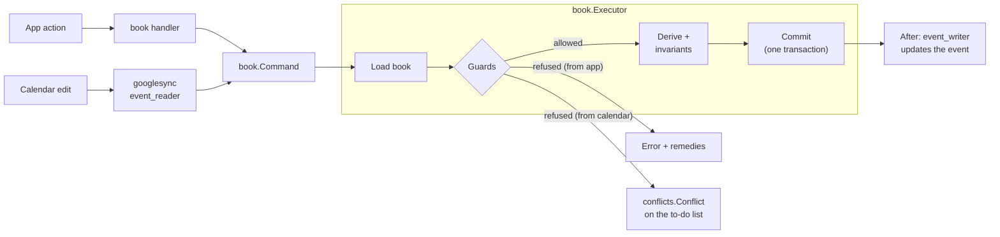

# bizzy

Back-office for a one-person physio practice: sessions, packages, invoices and receipts, follow-ups, expenses. Sessions can be booked in Google Calendar or in the app.

## Design principles

1. **bizzy is the truth; Google Calendar is a command surface.** A calendar edit is read as the same command the app would send and decided by the same rules. Refused edits wait on the to-do list with remedies. Google Contacts stays the truth for contact details. The app keeps a read-only copy.
2. **Documents own money.** A fee is its invoice line and a payment its receipt line. Drafts are made with every booking and payment, and stay editable until issued. Issued documents are immutable apart from non-legal corrections. Anything else goes through cancelling (later, credit/debit notes).
3. **The app never reaches an invalid state.** Every change is judged by one guard table. A refusal changes nothing and offers the remedies that would let it through.
4. **No business rule in the web app.** The API returns views with state, rules, to-do items and `can` verdicts. The web only renders them.
5. **Every state is listed.** Entity states, rules, guards and cross-entity links are golden files in `testdata/`, so a review shows what moved. A property-based simulation checks that they hold.

Conventions: new identifiers say "user", never "her". Only `development` is deployed, so breaking schema changes need no migration: redeploy or **Settings → Reset**.

## Tech stack

| Folder | What | Stack |
| --- | --- | --- |
| `bizzy-web` | The app (SPA) | React 19, Vite, TanStack Router / Query / Form / Table, Tailwind, shadcn/ui, Amplify auth, react-pdf, Vitest |
| `bizzy-lambda` | API, calendar/contacts sync, jobs | Go, DynamoDB (single table), S3, `pgregory.net/rapid` |
| `bizzy-infra` | AWS resources | CDK (TypeScript) |

Sign-in is Google via Cognito. Only `ALLOWED_EMAIL` gets identity-pool credentials, and the browser uses them to invoke the API Lambda directly (no API Gateway). Google Calendar and Contacts are reached through a separate OAuth consent (**Settings → Connect Google**), with the refresh token stored in SSM.

## Code layout

```
bizzy-infra/    bin/bizzy-infra.ts → lib/{auth,data,api,web}-stack.ts, constructs in lib/common/
bizzy-lambda/   cmd/{api,public,job-quarterly}/main.go, internal/…
bizzy-web/      src/main.tsx, src/routes/ (file routes), src/features/<feature>/
scripts/        web-env.mjs: writes bizzy-web/.env.<env> from stack outputs
```

### bizzy-infra

Entry point: [bin/bizzy-infra.ts](bizzy-infra/bin/bizzy-infra.ts). It reads `.env.<ENVIRONMENT>` and creates four stacks, `<project>-<env>-{auth,data,api,web}`:

- **auth**: Cognito user pool (Google IdP) and identity pool, with role mapping to `ALLOWED_EMAIL`.
- **data**: the DynamoDB table (5 generic LSIs, created up front) and the attachments bucket (versioned with 35-day noncurrent expiry in production).
- **api**: the `api`, `public` (share links, Function URL, `GetItem` only) and `job-quarterly` (EventBridge) Go Lambdas.
- **web**: S3 and CloudFront hosting the SPA.

### bizzy-lambda

Entry points: [cmd/api](bizzy-lambda/cmd/api/main.go) (all app actions), [cmd/public](bizzy-lambda/cmd/public/main.go) (share links), [cmd/job-quarterly](bizzy-lambda/cmd/job-quarterly/main.go) (upkeep tasks). `api` wires dependencies in `internal/app` and dispatches `{action, payload}` through `internal/router`, where each action is registered as a `Query` or a `Mutation`.

**How a change happens.** Sessions, packages, payments, documents and follow-ups change only through `book`:



- `googlesync` reads each changed event as the command the user meant (`event_reader.go`), the same command the app sends, marked `FromCalendar`. So the calendar can do exactly what the app can. The title syntax is in `calendar/syntax.go`.
- The executor applies the command to a copy of the client's book. Each guard (`book/guards.go`) compares before and after, so guards judge what a command does, not what it claims to do. `derive.go` fills copied fields. `invariants.go` must hold. The change commits in one transaction with version checks and retries on conflict.
- After the commit, `event_writer.go` pushes the change to its event. A failed push is finished by the next sync.
- A refused calendar edit becomes a conflict keyed `CONFLICT / <surface>#<externalId>` and offers the guards' remedies. It is re-judged after every change.

**Layout:**

- `internal/features/<feature>/`: one slice per package, with files named by layer: `model.go`, `repository.go`, `handler.go`, `service.go`, `state.go` (axes), `rules.go` (rule table that the to-do list is derived from), `guards.go`, `view.go`. Other files are named after what they do, never `util`/`helper`.
- Workflow slices (`book`, `googlesync`, `todo`) may import core slices (`clients`, `sessions`, `packages`, `documents`, `conflicts`, …), never the reverse.
- `internal/platform/`: infrastructure (`dynamo`, `command` = guard table, `statemodel`, `apperr`, `googleauth`, `blobstore`, `ssm`). `internal/schema`: every DynamoDB key. `internal/shared/`: behaviour-less shared types.
- `internal/integrity`: cross-entity rules, golden output in `testdata/links.md`. `Pending` marks a known gap.
- `internal/simulation`: rapid state machine over `internal/app` with in-memory stores and fake Google (`internal/testutil`). It has one action per router mutation (a test enforces this) plus calendar and contacts edits, clock moves and crashes.
- A new entity adds `state.go`, `rules.go`, guards and simulation actions.

### bizzy-web

Entry point: [src/main.tsx](bizzy-web/src/main.tsx) → `router.tsx` → `src/routes/` (TanStack file routes, which only read params and render a page). The API is called through `invoke(action, payload)` in `core/lambda/lambda.client.ts`.

- `src/features/<feature>/` files are `<kebab-name>.<layer>.ts(x)`, with exactly one dot before the layer. Layers in dependency order: `types`, `constant`, `util`, `form`, `service`, `query` / `mutation`, `hook`, `columns`, `component`.
- Pages are `x-page.component.tsx` at the feature root. Other components live in `components/<name>/`.
- Components reach data only through `query`, `mutation` and `hook`, never a `service`.
- `core/` holds shared infrastructure, `components/shared/` the app's shared components, and `components/ui/` the generated shadcn components (left untouched).
- Tests mirror the file they test: `x.util.ts` → `x.util.test.ts`.

## Development setup

Requires Node 24, pnpm 10, Go (see `go.mod`) and the AWS CLI. The local frontend runs against the real `development` stacks.

1. **Google Cloud**: enable the Calendar and People APIs. Publish the OAuth consent screen with scopes `calendar.events`, `calendar.calendarlist.readonly` and `contacts` (in "Testing", refresh tokens expire after 7 days). Create a Web OAuth client with redirect URIs `https://<project>-<env>.auth.<region>.amazoncognito.com/oauth2/idpresponse` and `<app origin>/google-callback`.
2. `cp bizzy-infra/.env.example bizzy-infra/.env.development` and fill it in. Use `http://localhost:4200/` as callback/logout URL and your email as `ALLOWED_EMAIL`.
3. `pnpm install && pnpm aws:login && pnpm dev:deploy`
4. `pnpm web:dev`, open http://localhost:4200, and connect a **test** Google account in Settings.

Staging (`main`) and production (`production`) deploy from GitHub Actions ([deploy.yml](.github/workflows/deploy.yml)). They need `cdk bootstrap`, an OIDC role, and GitHub environments with the variables and secrets listed in that workflow. None of these exist yet.

## Commands

```sh
pnpm dev:deploy        # deploy development stacks + write bizzy-web/.env.development
pnpm lambda:deploy     # hotswap development Lambdas after Go changes
pnpm web:dev           # http://localhost:4200
pnpm web:env           # rewrite the web env only
pnpm cdk:diff

pnpm web:test | web:lint | web:typecheck
pnpm infra:test | infra:lint | infra:typecheck
pnpm lambda:test | lambda:vet
```

Golden files and deeper runs (from `bizzy-lambda/`):

```sh
go test ./... -run TestStates -update                      # entity state tables
go test ./internal/features/book -run TestGuards -update   # guard table
go test ./internal/integrity -update                       # cross-entity links
go test ./internal/features/book -guards.necessity         # every guard must matter
go test ./internal/simulation -rapid.checks=2000 -rapid.steps=200 -sim.coverage -sim.report=out.md
```

## Open decisions

- **Package credits by duration**: 1 credit = 1 h, rounded down to 15 min, with the shortfall charged at the usual fee. Still open: is the usual fee hourly? Should a session spill into the next package? Where do overrides live? What does `10x85` mean (sessions or hours)?
- **Alias remedy**: for a calendar name that is a near miss, "Add as <client>'s calendar name" currently opens the client page. Nothing is prefilled, and the waiting edit then needs **Apply it**. Try it in dev, then decide whether an inline dialog on the to-do row should replace it: add the alias and apply the edit in one tap.
