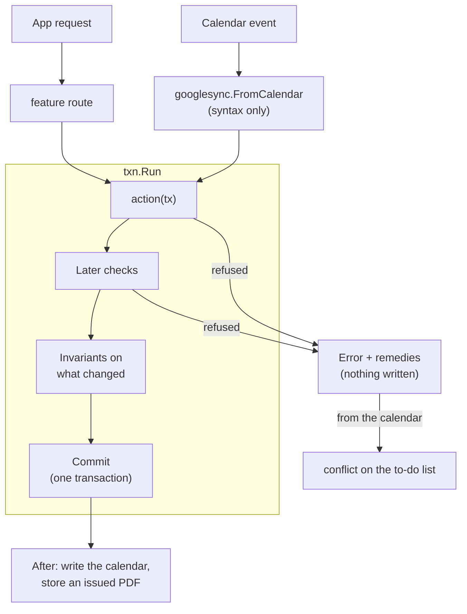

# bizzy

Back-office for a one-person physio practice: sessions, packages, invoices and receipts, follow-ups, expenses. Sessions are booked in Google Calendar or in the app.

## Design principles

1. **bizzy is the truth; Google Calendar is a command surface.** A calendar edit is read as the command the app would send, under the same rules. Every event in the chosen calendar is bizzy's (a session, a follow-up `!`) or refused. A refused edit waits on the to-do list with remedies, one of which always puts bizzy's version back. Google Contacts is the truth for contact details (the app keeps a read-only copy); a client's IC or passport number is bizzy's.
2. **Documents own money.** A fee is its invoice line, a payment its receipt line. Drafts are made with every booking and payment and stay editable until issued. An issued document changes only by non-legal corrections (a new revision) or by cancelling.
3. **An issued document is printed once.** Issuing renders the PDF in the API and commits its SHA-256 with the revision; the file is then kept in S3 (locked for 7 years in production) and served as kept, stamped CANCELLED once cancelled. A lost file is re-rendered only if it matches the hash. So the layout can change freely: only new documents look new. Drafts render fresh, watermarked DRAFT.
4. **The app never reaches an invalid state.** Every change is an action that checks its rules before anything is written. A refusal changes nothing and offers remedies. Invariants are checked again before every commit.
5. **Delete undoes a mistake; history stays.** An item with history (it happened, something was recorded, money or an issued document covers it) is cancelled or archived instead (see [Lifecycle](#lifecycle)), and stays readable.
6. **No business rule in the web app.** Every view carries `can` (a verdict per action: ok, or why not plus remedies) and `locked` (fields its update can't change now). The web shows and disables by them, never by reading state. PDFs come from the API too.
7. **Every rule is tested by use.** A property-based simulation drives every action, the calendar and the clock in random order, checking every invariant after every step.

Conventions: identifiers say "user", never "her". Until production holds data, a change to how items are stored is a reset, not a migration: delete `bizzy-lambda/SCHEMA.md`, regenerate it, deploy and **Settings → Reset** (development and staging only). After that, every such change is a [migration](#migrations).

## Tech stack

| Folder | What | Stack |
| --- | --- | --- |
| `bizzy-web` | The app (SPA) | React 19, Vite, TanStack Router / Query / Form / Table, Tailwind, shadcn/ui, Amplify auth, Vitest |
| `bizzy-lambda` | API, calendar/contacts sync, PDFs, jobs | Go, DynamoDB (single table), S3, fpdf, `pgregory.net/rapid` |
| `bizzy-infra` | AWS resources | CDK (TypeScript) |

Sign-in is Google via Cognito. Only `ALLOWED_EMAIL` gets identity-pool credentials, which the browser uses to invoke the API Lambda directly (no API Gateway). Calendar and Contacts use a separate OAuth consent (**Settings → Connect Google**); the refresh token is in SSM.

## Code layout

```
bizzy-infra/    bin/bizzy-infra.ts → lib/{auth,data,api,web}-stack.ts, constructs in lib/common/
bizzy-lambda/   cmd/{api,public,job-quarterly,migrate}/main.go, internal/{app,features,migrations,platform,calendar,simulation,testutil}/
bizzy-web/      src/main.tsx, src/routes/ (file routes), src/features/<feature>/
scripts/        web-env.mjs: writes bizzy-web/.env.<env> from stack outputs
```

### bizzy-infra

[bin/bizzy-infra.ts](bizzy-infra/bin/bizzy-infra.ts) reads `.env.<ENVIRONMENT>` and creates `<project>-<env>-{auth,data,api,web}`:

- **auth**: Cognito user pool (Google IdP) and identity pool, mapped to `ALLOWED_EMAIL`.
- **data**: the DynamoDB table (5 generic LSIs, created up front) and the file bucket: `attachments/` and issued PDFs under `documents/`. Production versions it (35-day noncurrent expiry) and has Object Lock on.
- **api**: the `api`, `public` (share links: a Function URL that can only `GetItem` and read issued PDFs), `job-quarterly` (EventBridge) and `migrate` (run by deploys) Go Lambdas.
- **web** (staging and production): S3 and CloudFront for the SPA. A deploy drops the previous build's files.

### bizzy-lambda

[cmd/api](bizzy-lambda/cmd/api/main.go) builds [internal/app](bizzy-lambda/internal/app/app.go), which wires one `txn.Runner`, the calendar sync and every feature's routes. The router dispatches `{action, payload}` to a `Query` or a `Mutation`.

**Every change is an action run by `txn.Run`**, whether from the app or the calendar:



- **Actions** are plain functions of a `txn.Tx` (`sessions.Update(tx, id, fields)`); nothing is written until they return. `Fields` is a patch, applied in steps that each check their rules and refuse with `apperr.Refused(message, remedies…)`. Rules across items (overlap) use `tx.Later`, so changes made together are judged together.
- **Invariants** (`<feature>/invariants.go`) are checked on every item a commit changes. One that breaks is a bug: an internal error, nothing written.
- **Commits are serial**: each moves one counter; an action that lost the race reruns on fresh data.
- **The calendar is an adapter.** `googlesync` keeps a `Link` per event (its session, and what both said when last agreed). A changed event becomes `sessions.Create`/`Update` with only what the user changed, one commit per event; a deleted one deletes its session, or cancels it when it has history. Refused events retry after the others (together, for a swap), then wait as conflicts. Changed sessions are written to their events after each commit; the next sync finishes a failed write. A calendar is read 60 days back, then backfilled a month per `sync.backfill`. Choosing another calendar keeps bizzy's data, writes every item into the new one and leaves the old one untouched.
- **PDFs** are laid out by `platform/pdflayout`, a small QuestPDF-style layer over fpdf: blocks (`Text`, `Row`, `Column`, `Flow`, `Table`, …) measure their height and draw themselves, and pages break between blocks only (a table between rows, its header repeated). Output is byte-for-byte repeatable, which the hash relies on. [documents/render.go](bizzy-lambda/internal/features/documents/render.go) is the layout; `pdf.go` keeps and serves the files (`documents.pdf`, `documents.preview`, the share link).

**Names** are the same in every feature. Outside a package you read `sessions.View`; the web writes `SessionView`.

| Role | Name | ASP.NET Core equivalent |
| --- | --- | --- |
| Stored entity | `Session` | Entity |
| Its storage | `Sessions` (a `txn.Kind`) | `DbSet<T>` / repository |
| What an action changes | `Fields` (a patch) | Command model |
| Actions | `Create`, `Update`, `Delete`, … | Application service / handler |
| Route input | `createRequest`, `idRequest`, … (private to `api.go`) | `XxxRequest` |
| Route output | `View` (never the stored entity) | Response DTO / view model |
| Routes | `Routes(r, run)` | Controller |
| Whether an action would be taken | `Can<Action>(tx, item) error` → the view's `Can` | Policy / authorization handler |
| Fields an update can't change now | `Locks(tx, item)` → the edit view's `Locked` | Read-only field metadata |
| Rules that always hold | `Invariants` | Domain invariants |
| Wiring | `app.New` | DI container / `Program.cs` |

**Layout:**

- `internal/features/<feature>/`: `api.go` (routes, views, requests, `Locks`), the entity file (model, `txn.Kind`, to-do), `actions.go` (actions and their `Can…`), `invariants.go`, and a file per other job (`translate.go`, `render.go`). Features import only what they build on; `app` passes in the reverse (`clients.Owner`). [app/dependencies_test.go](bizzy-lambda/internal/app/dependencies_test.go) enforces it.
- `internal/platform/`: `router`, `apperr`, `txn`, `table` (storage interface, in-memory version, shared contract), `listing`, `migrate`, `dynamo`, `blobstore` (S3), `pdflayout`, `googleauth`, `ssm`. Imports no feature.
- **Long lists are searched, not loaded**: a `<feature>.search` query takes a `listing.Request` (words, days, the page to start after) and its filters, narrows the read with an index (`txn.List`: by time, client, tag or open), filters the rest in Go (not DynamoDB filter expressions, which bill every item read and can't see what a view works out), and returns a `listing.Page`, latest first, ending when full or after `listing.Budget` items.
- **A list across kinds** (`timeline.search`) pages one kind (a client's sessions) and takes the others within the time each page spans; its cursor carries both. What is coming comes whole with the first page.
- `internal/calendar`: Google Calendar events, title syntax and client, knowing no feature.
- `internal/testutil`: `testapp` (the whole app on the memory table, with fake Calendar, Contacts and S3).
- `internal/simulation`: a rapid state machine over `testapp`, one action per mutation (enforced) plus calendar edits and clock moves. After each step it checks every invariant, that a refusal changed nothing, that each view's `can` matches the API, that every issued PDF is kept as issued, and that once synced the calendar shows bizzy.
- **Refusals are written once**, as a read-only `Can<Action>(tx, item) error` the action calls first. Each view has a `Can` struct (`apperr.VerdictOf`) and, for an update with rules, `Locked` (`apperr.LocksOf`, keyed by JSON path). The simulation calls each mutation as its view said (`callAsViewed`, `callAsLocked`); the action's refusal stays the last word.
- **Storage**: one partition per kind (`PK` = `SESSION`, `SK` = id), the item's JSON in `data`, five LSIs (time, client, open, tag, ref) filled through `txn.Meta`. [SCHEMA.md](bizzy-lambda/SCHEMA.md) is generated from the code; a test fails when it is stale.
- **A new feature** adds those four files, three lines in `app/app.go` (routes, invariants, kinds), a row in `dependencies_test.go`, a `Doc` per kind, a `Can…` per action in its view, a place in [Lifecycle](#lifecycle), and a simulation action per mutation.

#### Lifecycle

**Delete** is for a mistake, refused once the item has history. After that it is **Cancelled** (void, kept as it was) or **Archived** (put away, undone by unarchiving). Both stay readable, behind a list chip.

| Entity | Delete while | Then |
| --- | --- | --- |
| Session | not happened (or tentative), nothing recorded, no payment, no issued invoice | **Cancel**: keeps its record, holds no time, costs nothing (credits freed, fee line dropped, a package bought in it kept), leaves the calendar |
| Client | nothing of theirs | **Archive**: out of lists and pickers, nothing new booked until unarchived |
| Package | no credits used, no payment, no issued invoice | Stays; the list hides it once used up and paid |
| Document | a draft never issued (discard) | **Cancel**: number stays used, PDF stamped CANCELLED, lines go back to a draft |

#### Migrations

The table's SQL-style migrations. The code serves only a table at its own version (`migrations.Version`, in the `SCHEMA` item), so it reads items in the shape it writes them.

- **Every change to a stored type or a `Meta`** needs one (once production holds data; see Conventions). `TestSchema` refuses to `-update` SCHEMA.md without one. One with no `Up` is enough when no item needs changing by hand: every run rewrites every item as the code writes it.
- **Writing one**: `internal/migrations/NNN_<what>.go`, appended to `All` (never reorder or change a deployed one). It works on stored JSON (`migrate.EachItem`), never a feature's types, imports only `platform`, changes nothing when run twice, and has `testdata/NNN/{before,after}.json`.
- **Deploying**: CI dry-runs the migrations on an in-memory copy, deploys, then invokes `cmd/migrate`: back up (production; backups older than 35 days are deleted, point-in-time recovery covers them), raise the fence (requests get `unavailable`), migrate, decode every item strictly, rewrite them, check every invariant, lower the fence. A failure leaves the fence up until a fixed migration runs.

### bizzy-web

[src/main.tsx](bizzy-web/src/main.tsx) → `router.tsx` → `src/routes/` (file routes that only read params and render a page). The API is called through `invoke(action, payload)` in `core/lambda/lambda.client.ts`.

- `src/features/<feature>/` files are `<kebab-name>.<layer>.ts(x)`, one dot before the layer. Layers in dependency order: `types`, `constant`, `util`, `form`, `service`, `query` / `mutation`, `hook`, `columns`, `component`.
- Pages are `x-page.component.tsx` at the feature root; other components live in `components/<name>/`. Components reach data only through `query`, `mutation` and `hook`, never a `service`.
- A feature's `types` mirror its `api.go`: output is `<Entity>View`, what a create or update sets is `<Entity>Fields` (an update sends only what changed), other input `<Action><Entity>Request`.
- `core/` is shared infrastructure, `components/shared/` the app's shared components, `components/ui/` the generated shadcn components (left untouched).
- **The web reads `can` and `locked`, never state, to decide what's allowed.** An `Action`'s `can` disables it and says why (a tooltip, or a line in the ⋯ menu). Forms disable what `locked` names, with a `LockedHint` under the field. Status is only shown (badges).
- Actions are laid out by an `ActionBar`: a page's in its header, a section's beside its heading. A crowded bar folds all but its main action behind ⋯ below `lg` (`foldBelow`). A section with state of its own (ticked rows) is a hook returning its `PageSection`.
- Every list page has one `FilterBar`: words plus facet chips, kept in the URL (`core/filter`). Endless lists (sessions, documents, follow-ups, expenses) use their `search` route and `usePages`; lists loaded whole (clients, packages) filter in the browser.
- **Documents are shown as the API's PDF** (`DocumentPdfView`, a frame, or a button where the browser can't show PDFs inline). The editor previews through `documents.preview`.
- Tests mirror the file they test: `x.util.ts` → `x.util.test.ts`.

## Development setup

Requires Node 24, pnpm 10, Go (see `go.mod`) and the AWS CLI. The local frontend runs against the real `development` stacks.

1. **Google Cloud**: enable the Calendar and People APIs. Publish the OAuth consent screen with scopes `calendar.events`, `calendar.calendarlist.readonly` and `contacts` (in "Testing", refresh tokens expire after 7 days). Create a Web OAuth client with redirect URIs `https://<project>-<env>.auth.<region>.amazoncognito.com/oauth2/idpresponse` and `<app origin>/google-callback`.
2. `cp bizzy-infra/.env.example bizzy-infra/.env.development` and fill it in, with `http://localhost:4200/` as callback/logout URL and your email as `ALLOWED_EMAIL`.
3. `pnpm install && pnpm aws:login && pnpm dev:deploy`
4. `pnpm web:dev`, open http://localhost:4200, and connect a **test** Google account in Settings.

Staging (`main`) and production (`production`) deploy from GitHub Actions ([deploy.yml](.github/workflows/deploy.yml)). They need `cdk bootstrap`, an OIDC role (which also reads the table and invokes `migrate`), and GitHub environments with the variables and secrets that workflow lists. None exist yet.

## Commands

```sh
pnpm dev:deploy          # deploy development stacks, migrate, write bizzy-web/.env.development
pnpm lambda:deploy       # hotswap development Lambdas after Go changes, then migrate
pnpm lambda:migrate:dry  # what the next deploy's migrations would do (writes nothing)
pnpm web:dev             # http://localhost:4200
pnpm web:env             # rewrite the web env only
pnpm cdk:diff
pnpm cdk:gc              # delete old Lambda builds no stack uses from the CDK assets bucket

pnpm web:test | web:lint | web:typecheck
pnpm infra:test | infra:lint | infra:typecheck
pnpm lambda:test | lambda:vet
```

From `bizzy-lambda/`:

```sh
go test ./internal/simulation -rapid.checks=1000 -rapid.steps=300
go test ./internal/features/documents -run TestRender -update   # rewrite the sample PDFs in testdata/ after a layout change, then open them
TABLE_NAME=<dev table> go test ./internal/platform/dynamo       # the table contract against real DynamoDB
```

## If share links are flooded

`public` is the only thing anyone can call; every call is billed and reads the table, whose small provisioned capacity the app shares. The account's limit of 10 concurrent executions caps a flood. If that limit is raised, cap `public` too (`reservedConcurrentExecutions: 2` in [api-stack.ts](bizzy-infra/lib/api-stack.ts)).

To stop it at once (share links fail, everything else works):

```sh
aws lambda put-function-concurrency --function-name bizzy-<env>-public \
  --reserved-concurrent-executions 0 --profile hozhuyi.dev --region ap-southeast-1
aws lambda delete-function-concurrency --function-name bizzy-<env>-public \
  --profile hozhuyi.dev --region ap-southeast-1   # turn it back on
```

Resetting a document's token kills one leaked link; this kills them all until turned back on.
