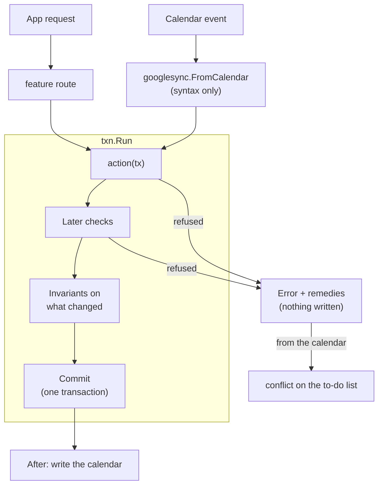

# bizzy

Back-office for a one-person physio practice: sessions, packages, invoices and receipts, follow-ups, expenses. Sessions can be booked in Google Calendar or in the app.

## Design principles

1. **bizzy is the truth; Google Calendar is a command surface.** A calendar edit is read as the same command the app would send and decided by the same rules. Every event in the chosen calendar is bizzy's: a session, a follow-up (`!`), or refused. Refused edits wait on the to-do list with remedies, one of which always puts bizzy's version back (for an event that shows nothing of bizzy's, that deletes it). Google Contacts stays the truth for contact details. The app keeps a read-only copy.
2. **Documents own money.** A fee is its invoice line and a payment its receipt line. Drafts are made with every booking and payment, and stay editable until issued. Issued documents are immutable apart from non-legal corrections. Anything else goes through cancelling (later, credit/debit notes).
3. **The app never reaches an invalid state.** Every change is an action that checks its own rules before anything is written. A refusal changes nothing and offers the remedies that would let it through. Invariants are checked again before every commit.
4. **No business rule in the web app.** The API returns views with state, rules, to-do items and `can` verdicts. The web only renders them.
5. **Every rule is tested by use.** A property-based simulation drives every action, the calendar and the clock in random order and checks every invariant after every step.

Conventions: new identifiers say "user", never "her". Only `development` is deployed, so breaking schema changes need no migration: redeploy or **Settings → Reset**.

## Tech stack

| Folder | What | Stack |
| --- | --- | --- |
| `bizzy-web` | The app (SPA) | React 19, Vite, TanStack Router / Query / Form / Table, Tailwind, shadcn/ui, Amplify auth, react-pdf, Vitest |
| `bizzy-lambda` | API, calendar/contacts sync, jobs | Go, DynamoDB (single table), S3, `pgregory.net/rapid` |
| `bizzy-infra` | AWS resources | CDK (TypeScript) |

Sign-in is Google via Cognito. Only `ALLOWED_EMAIL` gets identity-pool credentials, and the browser uses them to invoke the API Lambda directly (no API Gateway). Google Calendar and Contacts are reached through a separate OAuth consent (**Settings → Connect Google**), with the refresh token stored in SSM.

## Code layout

```
bizzy-infra/    bin/bizzy-infra.ts → lib/{auth,data,api,web}-stack.ts, constructs in lib/common/
bizzy-lambda/   cmd/api/main.go, internal/… (old code in bizzy-lambda-old/ during the rebuild)
bizzy-web/      src/main.tsx, src/routes/ (file routes), src/features/<feature>/
scripts/        web-env.mjs: writes bizzy-web/.env.<env> from stack outputs
```

### bizzy-infra

Entry point: [bin/bizzy-infra.ts](bizzy-infra/bin/bizzy-infra.ts). It reads `.env.<ENVIRONMENT>` and creates four stacks, `<project>-<env>-{auth,data,api,web}`:

- **auth**: Cognito user pool (Google IdP) and identity pool, with role mapping to `ALLOWED_EMAIL`.
- **data**: the DynamoDB table (5 generic LSIs, created up front) and the attachments bucket (versioned with 35-day noncurrent expiry in production).
- **api**: the `api`, `public` (share links, Function URL, `GetItem` only) and `job-quarterly` (EventBridge) Go Lambdas.
- **web**: S3 and CloudFront hosting the SPA.

### bizzy-lambda

**Rebuilt** around one change path (below); every feature is back. The old code is in `bizzy-lambda-old/` for reference. Items are stored differently from before, so after deploying, run **Settings → Reset** once: it deletes everything the new code can't read, the old Google connection included, so connect Google again afterwards.

The web app still calls the old API. What changed, for updating it:

- `clients.save`, `packages.save` and `expenses.save` are each `create` and `update`. Edits are patches: what isn't sent stays as it is.
- `sessions.create` / `update` take `{clientId, time: {start, end}, tentative, location, fee: {cents}, package: {bought: {sessions, priceCents}}, updatePayment}`; `fee: {}` returns to a credit or the usual fee, `package: {}` drops the package bought in it. `sessions.get` returns the view and its notes. `billing.preview` is `sessions.preview`.
- `payments.set` on a session pays everything it owes: its fee and the package bought in it.
- Documents have no `version`; `documents.get` returns the view with its revisions.
- `followUps.create` / `update` take `when: {date}` or `when: {start, minutes}`.
- Conflicts are keyed by event id (`calendar.revert` and `conflicts.apply` take `{id}`); `calendar.ignore` is gone (`calendar.revert` deletes an event bizzy doesn't show). `sync.run` takes nothing: it reads what changed since the last run.
- A client's activity is `activity.list`, not part of the client. A rule's refusal has code `refused` (not `conflict`), no `guard`, and its remedies' `input` is `request`.

Entry point: [cmd/api](bizzy-lambda/cmd/api/main.go) builds [internal/app](bizzy-lambda/internal/app/app.go), which wires one `txn.Runner`, the sync and every feature's routes. The router dispatches `{action, payload}` to a `Query` or a `Mutation`.

**How a change happens.** Every change is an action run by `txn.Run`:



- **An action** is a plain function of a `txn.Tx`, e.g. `sessions.Update(tx, id, fields)`. It reads and changes items through the `Tx`, and nothing is written until it returns. `Fields` is a patch: only what was set changes. Each field has a small step in a fixed order (`reassign`, `reschedule`, …) that checks its own rules and refuses with `apperr.Refused(message, remedies…)`. Rules about how a change sits among other items (overlap) use `tx.Later`, so changes made together are judged together.
- **Invariants** (`<feature>/invariants.go`) hold for every stored item. The Runner checks them on every item a commit changes, and the simulation on every item after every step. One that breaks is a bug in an action, reported as an internal error, and nothing is written.
- **Commits happen one at a time.** Every commit moves one counter. If another commit went first, the action reruns on fresh data. Actions need no thought about concurrency.
- **The calendar** is an adapter: sessions know nothing of it. `googlesync` keeps a `Link` per event (which session it shows, and what it said when bizzy and the calendar last agreed). Each changed event goes to `googlesync.FromCalendar`, which checks only the title syntax and calls the same `sessions.Create`/`Update`/`Delete` with what the user changed (compared with `Link.Seen`). One event is one commit. A refused event is retried after the others, events refused only for where they'd land are tried together (a swap), and the rest wait as conflicts with the action's remedies plus "put bizzy's version back". After every commit, changed sessions are written to their events. A link whose session was deleted marks an event still to delete. The next sync finishes any write that failed.

**Names.** Every feature uses the same names for the same roles. The package names the entity, so outside it you read `sessions.View` and `clients.View`. The web prefixes them instead: `SessionView`, `ClientView`.

| Role | Name | ASP.NET Core equivalent |
| --- | --- | --- |
| Stored entity | `Session`, `Client` | Entity |
| Its storage | `Sessions`, `Clients` (a `txn.Kind`) | `DbSet<T>` / repository |
| What an action changes | `Fields` (a patch) | Command model |
| Actions | `Create`, `Update`, `Delete`, … | Application service / handler |
| Route input | `createRequest`, `updateRequest`, `idRequest` (private to `api.go`) | `XxxRequest` |
| Route output | `View` | Response DTO / view model |
| Routes | `Routes(r, run)` | Controller |
| Rules that always hold | `Invariants` | Domain invariants |
| Wiring | `app.New` | DI container / `Program.cs` |

A route never returns a stored entity: stored fields can change without changing the API.

**Layout:**

- `internal/features/<feature>/`: every feature has its routes, views and requests in `api.go`. The other files are its entity (if it has one: model, its `txn.Kind`, its to-do), `actions.go` and `invariants.go`, plus a file named for anything else it does (`translate.go`, `push.go`). A feature imports the features it builds on, never the reverse. When the reverse is needed, `app` passes it in (e.g. `clients.Owner`). [app/dependencies_test.go](bizzy-lambda/internal/app/dependencies_test.go) lists what each feature may import and fails on any other import: `platform` imports no feature, `calendar` none either.
- `internal/platform/`: `router`, `apperr`, `txn` (Tx, Kind, Runner, Invariant), `table` (the storage interface, its in-memory version and the contract both must meet), `dynamo` (the DynamoDB table), `blobstore` (S3), `googleauth`, `ssm`.
- `internal/calendar`: Google Calendar (events, title syntax, client) with no knowledge of features.
- `internal/testutil`: `testapp` (the whole app on the memory table and fakes of Google Calendar, Google Contacts and S3), `fakecal`, `fakecontacts`, `memblob`.
- `internal/simulation`: a rapid state machine over `testapp`. It has one action per router mutation (a test enforces this), plus calendar edits and clock moves. After each step it checks every invariant, that a refused call changed nothing, that a view's `can` is what the API does, that the app never creates a conflict, that every attached file is there, and that once synced the calendar shows bizzy.
- **Storage**: one partition per kind (`PK` = `SESSION`, …, `SK` = id), the item's JSON in `data`, and five LSIs with one meaning each (time, client, open, tag, ref) that a kind fills through its `txn.Meta`. [SCHEMA.md](bizzy-lambda/SCHEMA.md) is every kind, its fields, its indexes and the invariants on it, generated from the code (a test fails when it is out of date).
- A new feature adds `<entity>.go`, `actions.go`, `invariants.go` and `api.go`, three lines in `app/app.go` (routes, invariants, kinds), its row in `app/dependencies_test.go`, a `Doc` on each kind (then `-update` SCHEMA.md), and a simulation action per mutation.

### bizzy-web

Entry point: [src/main.tsx](bizzy-web/src/main.tsx) → `router.tsx` → `src/routes/` (TanStack file routes, which only read params and render a page). The API is called through `invoke(action, payload)` in `core/lambda/lambda.client.ts`.

- `src/features/<feature>/` files are `<kebab-name>.<layer>.ts(x)`, with exactly one dot before the layer. Layers in dependency order: `types`, `constant`, `util`, `form`, `service`, `query` / `mutation`, `hook`, `columns`, `component`.
- Pages are `x-page.component.tsx` at the feature root. Other components live in `components/<name>/`.
- Components reach data only through `query`, `mutation` and `hook`, never a `service`.
- `core/` holds shared infrastructure, `components/shared/` the app's shared components, and `components/ui/` the generated shadcn components (left untouched).
- Tests mirror the file they test: `x.util.ts` → `x.util.test.ts`.

## Development setup

Requires Node 24, pnpm 10, Go (see `go.mod`) and the AWS CLI. The local frontend runs against the real `development` stacks.

1. **Google Cloud**: enable the Calendar and People APIs. Publish the OAuth consent screen with scopes `calendar.events`, `calendar.calendarlist.readonly` and `contacts` (in "Testing", refresh tokens expire after 7 days). Create a Web OAuth client with redirect URIs `https://<project>-<env>.auth.<region>.amazoncognito.com/oauth2/idpresponse` and `<app origin>/google-callback`.
2. `cp bizzy-infra/.env.example bizzy-infra/.env.development` and fill it in. Use `http://localhost:4200/` as callback/logout URL and your email as `ALLOWED_EMAIL`.
3. `pnpm install && pnpm aws:login && pnpm dev:deploy`
4. `pnpm web:dev`, open http://localhost:4200, and connect a **test** Google account in Settings.

Staging (`main`) and production (`production`) deploy from GitHub Actions ([deploy.yml](.github/workflows/deploy.yml)). They need `cdk bootstrap`, an OIDC role, and GitHub environments with the variables and secrets listed in that workflow. None of these exist yet.

## Commands

```sh
pnpm dev:deploy        # deploy development stacks + write bizzy-web/.env.development
pnpm lambda:deploy     # hotswap development Lambdas after Go changes
pnpm web:dev           # http://localhost:4200
pnpm web:env           # rewrite the web env only
pnpm cdk:diff

pnpm web:test | web:lint | web:typecheck
pnpm infra:test | infra:lint | infra:typecheck
pnpm lambda:test | lambda:vet
```

Deeper runs (from `bizzy-lambda/`):

```sh
go test ./internal/simulation -rapid.checks=1000 -rapid.steps=300
TABLE_NAME=<dev table> go test ./internal/platform/dynamo   # the table contract against real DynamoDB
```

## Open decisions

- **Package credits by duration**: 1 credit = 1 h, rounded down to 15 min, with the shortfall charged at the usual fee. Still open: is the usual fee hourly? Should a session spill into the next package? Where do overrides live? What does `10x85` mean (sessions or hours)?
- **Alias remedy**: for a calendar name that is a near miss, "Add as <client>'s calendar name" currently opens the client page. Nothing is prefilled, and the waiting edit then needs **Apply it**. Try it in dev, then decide whether an inline dialog on the to-do row should replace it: add the alias and apply the edit in one tap.
