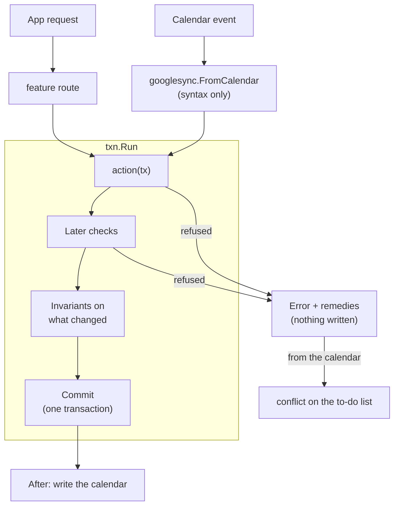

# bizzy

Back-office for a one-person physio practice: sessions, packages, invoices and receipts, follow-ups, expenses. Sessions can be booked in Google Calendar or in the app.

## Design principles

1. **bizzy is the truth; Google Calendar is a command surface.** A calendar edit is read as the same command the app would send and decided by the same rules. Every event in the chosen calendar is bizzy's: a session, a follow-up (`!`), or refused. Refused edits wait on the to-do list with remedies, one of which always puts bizzy's version back (for an event that shows nothing of bizzy's, that deletes it). Google Contacts stays the truth for contact details. The app keeps a read-only copy.
2. **Documents own money.** A fee is its invoice line and a payment its receipt line. Drafts are made with every booking and payment, and stay editable until issued. Issued documents are immutable apart from non-legal corrections. Anything else goes through cancelling (later, credit/debit notes).
3. **The app never reaches an invalid state.** Every change is an action that checks its own rules before anything is written. A refusal changes nothing and offers the remedies that would let it through. Invariants are checked again before every commit.
4. **No business rule in the web app.** The API returns views with state, rules, to-do items, `can` verdicts and `locked` fields. The web only renders them.
5. **Every rule is tested by use.** A property-based simulation drives every action, the calendar and the clock in random order and checks every invariant after every step.

Conventions: new identifiers say "user", never "her". Only `development` is deployed, so breaking schema changes need no migration: redeploy or **Settings → Reset**.

## Tech stack

| Folder | What | Stack |
| --- | --- | --- |
| `bizzy-web` | The app (SPA) | React 19, Vite, TanStack Router / Query / Form / Table, Tailwind, shadcn/ui, Amplify auth, react-pdf, Vitest |
| `bizzy-lambda` | API, calendar/contacts sync, jobs | Go, DynamoDB (single table), S3, `pgregory.net/rapid` |
| `bizzy-infra` | AWS resources | CDK (TypeScript) |

Sign-in is Google via Cognito. Only `ALLOWED_EMAIL` gets identity-pool credentials, and the browser uses them to invoke the API Lambda directly (no API Gateway). Google Calendar and Contacts are reached through a separate OAuth consent (**Settings → Connect Google**), with the refresh token stored in SSM.

## Code layout

```
bizzy-infra/    bin/bizzy-infra.ts → lib/{auth,data,api,web}-stack.ts, constructs in lib/common/
bizzy-lambda/   cmd/{api,public,job-quarterly}/main.go, internal/{app,features,platform,calendar,simulation,testutil}/
bizzy-web/      src/main.tsx, src/routes/ (file routes), src/features/<feature>/
scripts/        web-env.mjs: writes bizzy-web/.env.<env> from stack outputs
```

### bizzy-infra

Entry point: [bin/bizzy-infra.ts](bizzy-infra/bin/bizzy-infra.ts). It reads `.env.<ENVIRONMENT>` and creates four stacks, `<project>-<env>-{auth,data,api,web}`:

- **auth**: Cognito user pool (Google IdP) and identity pool, with role mapping to `ALLOWED_EMAIL`.
- **data**: the DynamoDB table (5 generic LSIs, created up front) and the attachments bucket (versioned with 35-day noncurrent expiry in production).
- **api**: the `api`, `public` (share links, Function URL, `GetItem` only) and `job-quarterly` (EventBridge) Go Lambdas.
- **web**: S3 and CloudFront hosting the SPA.

### bizzy-lambda

[cmd/api](bizzy-lambda/cmd/api/main.go) builds [internal/app](bizzy-lambda/internal/app/app.go), which wires one `txn.Runner`, the calendar sync and every feature's routes. The router dispatches `{action, payload}` to a `Query` or a `Mutation`.

**Every change is an action run by `txn.Run`**, whether it comes from the app or the calendar:



- **Actions** are plain functions of a `txn.Tx` (`sessions.Update(tx, id, fields)`); nothing is written until they return. `Fields` is a patch, applied in fixed steps that each check their own rules and refuse with `apperr.Refused(message, remedies…)`. Rules about other items (overlap) use `tx.Later`, so changes made together are judged together.
- **Invariants** (`<feature>/invariants.go`) are checked on every item a commit changes. One that breaks is a bug: an internal error, nothing written.
- **Commits are serial**: each moves one counter, and an action that lost the race reruns on fresh data.
- **The calendar is an adapter.** `googlesync` keeps a `Link` per event (the session it shows, and what it said when both last agreed). A changed event becomes the same `sessions.Create`/`Update`/`Delete` with only what the user changed, one commit per event. Refused events are retried after the others (together, for a swap); the rest wait as conflicts, with the remedies plus "put bizzy's version back". Changed sessions are written to their events after each commit, and the next sync finishes any failed write. A calendar is first read 60 days back, then backfilled a month per `sync.backfill` call. Choosing another calendar (typing its name to confirm) keeps all of bizzy's data: the sync forgets the old calendar's links, writes every item into the new one, and reads its events like any others. The old calendar is left untouched.

**Names** are the same in every feature. Outside a package you read `sessions.View`; the web writes `SessionView`.

| Role | Name | ASP.NET Core equivalent |
| --- | --- | --- |
| Stored entity | `Session` | Entity |
| Its storage | `Sessions` (a `txn.Kind`) | `DbSet<T>` / repository |
| What an action changes | `Fields` (a patch) | Command model |
| Actions | `Create`, `Update`, `Delete`, … | Application service / handler |
| Route input | `createRequest`, `idRequest`, … (private to `api.go`) | `XxxRequest` |
| Route output | `View` (never the stored entity) | Response DTO / view model |
| Routes | `Routes(r, run)` | Controller |
| Whether an action would be taken | `Can<Action>(tx, item) error` → the view's `Can` | Policy / authorization handler |
| Fields an update can't change now | `Locks(tx, item)` → the edit view's `Locked` | Read-only field metadata |
| Rules that always hold | `Invariants` | Domain invariants |
| Wiring | `app.New` | DI container / `Program.cs` |

**Layout:**

- `internal/features/<feature>/`: `api.go` (routes, views, requests, `Locks`), the entity file (model, `txn.Kind`, to-do), `actions.go` (actions and their `Can…` checks), `invariants.go`, and a file per other job (`translate.go`, `push.go`). Features import only what they build on; `app` passes in the reverse (`clients.Owner`). [app/dependencies_test.go](bizzy-lambda/internal/app/dependencies_test.go) enforces it.
- `internal/platform/`: `router`, `apperr`, `txn`, `table` (storage interface, in-memory version, shared contract), `listing` (searching a long list a page at a time), `dynamo`, `blobstore` (S3), `googleauth`, `ssm`. Imports no feature.
- **Long lists are searched, not loaded**: a `<feature>.search` query takes a `listing.Request` (words, days, the page to start after) and its own filters, narrows the read with an index (`txn.List`: by time, client, tag or open), filters the rest in Go, and returns a `listing.Page`, latest first. A page ends when full or after looking at `listing.Budget` items. Filters run in the Lambda, not as DynamoDB filter expressions, which bill every item read anyway and can't see what a view works out.
- `internal/calendar`: Google Calendar events, title syntax and client, with no knowledge of features.
- `internal/testutil`: `testapp` (the whole app on the memory table, with fakes of Google Calendar, Contacts and S3).
- `internal/simulation`: a rapid state machine over `testapp`, with one action per mutation (enforced) plus calendar edits and clock moves. After each step it checks every invariant, that a refusal changed nothing, that each view's `can` matches the API, and that once synced the calendar shows bizzy.
- **Refusals are written once**, as a `Can…` check the action calls. A view turns them into verdicts (`apperr.VerdictOf`) and field locks (`apperr.LocksOf`, keyed by the field's JSON path), which the simulation holds to what the API does (`callAsViewed`, `callAsLocked`). The action's refusal stays the last word.
- **Storage**: one partition per kind (`PK` = `SESSION`, `SK` = id), the item's JSON in `data`, and five LSIs (time, client, open, tag, ref) filled through `txn.Meta`. [SCHEMA.md](bizzy-lambda/SCHEMA.md) is generated from the code; a test fails when it is stale.
- **A new feature** adds those four files, three lines in `app/app.go` (routes, invariants, kinds), a row in `dependencies_test.go`, a `Doc` per kind (then `-update` SCHEMA.md), and a simulation action per mutation.

### bizzy-web

Entry point: [src/main.tsx](bizzy-web/src/main.tsx) → `router.tsx` → `src/routes/` (TanStack file routes, which only read params and render a page). The API is called through `invoke(action, payload)` in `core/lambda/lambda.client.ts`.

- `src/features/<feature>/` files are `<kebab-name>.<layer>.ts(x)`, with exactly one dot before the layer. Layers in dependency order: `types`, `constant`, `util`, `form`, `service`, `query` / `mutation`, `hook`, `columns`, `component`.
- Pages are `x-page.component.tsx` at the feature root. Other components live in `components/<name>/`.
- Components reach data only through `query`, `mutation` and `hook`, never a `service`.
- A feature's `types` mirror its `api.go`: a route's output is `<Entity>View` (`SessionView`), what a create or update sets is `<Entity>Fields` (sent as a patch on update: only what changed), and any other input is `<Action><Entity>Request`. The service calls each action by its API name.
- `core/` holds shared infrastructure, `components/shared/` the app's shared components, and `components/ui/` the generated shadcn components (left untouched).
- Forms disable what the view's `locked` names, with a `LockedHint` (its why and remedies) under the field.
- Every list page has one `FilterBar`: words, plus chips from the page's facets (a client, a stage, a month). The filter (`core/filter`) lives in the URL. Lists that grow without end (sessions, documents, follow-ups, expenses) send it to their `search` route and read pages with `usePages`. Lists loaded whole anyway (clients, packages) filter in the browser.
- Tests mirror the file they test: `x.util.ts` → `x.util.test.ts`.

## Development setup

Requires Node 24, pnpm 10, Go (see `go.mod`) and the AWS CLI. The local frontend runs against the real `development` stacks.

1. **Google Cloud**: enable the Calendar and People APIs. Publish the OAuth consent screen with scopes `calendar.events`, `calendar.calendarlist.readonly` and `contacts` (in "Testing", refresh tokens expire after 7 days). Create a Web OAuth client with redirect URIs `https://<project>-<env>.auth.<region>.amazoncognito.com/oauth2/idpresponse` and `<app origin>/google-callback`.
2. `cp bizzy-infra/.env.example bizzy-infra/.env.development` and fill it in. Use `http://localhost:4200/` as callback/logout URL and your email as `ALLOWED_EMAIL`.
3. `pnpm install && pnpm aws:login && pnpm dev:deploy`
4. `pnpm web:dev`, open http://localhost:4200, and connect a **test** Google account in Settings.

Staging (`main`) and production (`production`) deploy from GitHub Actions ([deploy.yml](.github/workflows/deploy.yml)). They need `cdk bootstrap`, an OIDC role, and GitHub environments with the variables and secrets listed in that workflow. None of these exist yet.

## Commands

```sh
pnpm dev:deploy        # deploy development stacks + write bizzy-web/.env.development
pnpm lambda:deploy     # hotswap development Lambdas after Go changes
pnpm web:dev           # http://localhost:4200
pnpm web:env           # rewrite the web env only
pnpm cdk:diff

pnpm web:test | web:lint | web:typecheck
pnpm infra:test | infra:lint | infra:typecheck
pnpm lambda:test | lambda:vet
```

Deeper runs (from `bizzy-lambda/`):

```sh
go test ./internal/simulation -rapid.checks=1000 -rapid.steps=300
TABLE_NAME=<dev table> go test ./internal/platform/dynamo   # the table contract against real DynamoDB
```
